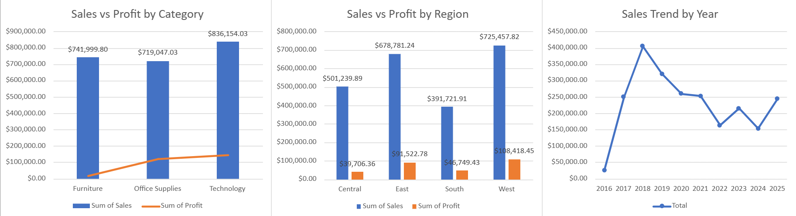

# Superstore Sales & Profit Dashboard (Excel)

**Tools:** Microsoft Excel · Pivot Tables · Calculated Fields · Slicers · Excel formulas

An interactive Excel dashboard that analyzes sales and profit for a retail superstore by product category, region and year, to show **where the business makes money and where it loses margin**.



---

## 1. Objective

Evaluate sales and profit performance across product categories, regions and years, and turn the findings into practical recommendations for margin improvement and resource allocation.

### Business questions

1. Which categories and regions generate the most sales and the most profit?
2. Where is the business selling a lot but earning little (low margin)?
3. How have yearly sales changed over time?

---

## 2. Dataset

| Item | Detail |
|---|---|
| Source | Superstore sales dataset: `<add dataset link>` |
| Grain | One row per order line |
| Fields used | Order date, category, region, segment, sales, profit |
| Currency | USD |

---

## 3. Approach

1. **Data cleaning:** converted the order date into a year field and handled blank entries with Excel formulas (`YEAR`, `IF`, `ISBLANK`).
2. **Aggregation:** built Pivot Tables for total sales and profit by category, region and year, and added a calculated field for profit margin.
3. **Dashboard:** built column and line charts connected to Region and Segment slicers so the whole dashboard filters together.
4. **Insights:** compared sales against profit margin (profit divided by sales) rather than profit alone.

---

## 4. Key Results

| KPI | Value |
|---|---|
| Total sales | $2,297,200.86 |
| Total profit | $286,397.02 |
| **Overall profit margin** | **12.5%** |

### Performance by category

| Category | Sales | Profit | Margin |
|---|---|---|---|
| Technology | $836,154.03 | $145,454.95 | 17.4% |
| Furniture | $741,999.80 | $18,451.27 | **2.5%** |
| Office Supplies | $719,047.03 | $122,490.80 | 17.0% |

### Performance by region

| Region | Sales | Profit | Margin |
|---|---|---|---|
| West | $725,457.82 | $108,418.45 | 14.9% |
| East | $678,781.24 | $91,522.78 | 13.5% |
| Central | $501,239.89 | $39,706.36 | **7.9%** |
| South | $391,721.91 | $46,749.43 | 11.9% |

### Key findings

1. **Technology is the strongest category.** It has the highest sales and profit, and generates about 51% of total profit at a 17.4% margin.
2. **Furniture sells a lot but earns very little.** It brings in $742K in sales (32% of the total) but only $18K in profit, a 2.5% margin compared with about 17% for Technology and Office Supplies.
3. **West leads, South is the smallest market.** West has the highest sales and profit. South has the lowest sales, about 17% of the total.
4. **Central has the weakest margin.** Its 7.9% margin is the lowest of the four regions, despite sales of over $500K.
5. **Yearly sales peaked in 2018.** Sales rise from about $25K in 2016 to a peak of about $405K in 2018, then fall to about $153K in 2024 before recovering to about $245K in 2025. <!-- Verify the year range against the original Order Date column before publishing; remove this item if the dates are wrong. -->

---

## 5. Recommendations

These are based on patterns in the data and should be tested before a full rollout.

1. **Review Furniture's cost structure and pricing.** Check discounting, product mix and shipping costs to find out why the margin is only 2.5%.
2. **Protect and grow Technology and Office Supplies.** Both combine strong sales with margins around 17%.
3. **Investigate Central before investing there.** Understand why its margin is much lower than West and East.
4. **Test targeted growth campaigns in South.** It is the smallest region, so a small pilot will show whether more investment pays off.

---

## 6. Limitations

- The analysis is descriptive: it shows where margins are low but not **why**, because the drivers (discounts, shipping and product costs) were not analyzed here.
- Margin is calculated at the category and region level, so differences between individual products are hidden.

---

## 7. Repository Structure

```
superstore-sales-dashboard/
├── README.md
├── images/
│   └── dashboard.png
└── dashboard/
    └── Superstore_Dashboard.xlsx
```

## 8. How to Use

1. Download `dashboard/Superstore_Dashboard.xlsx`.
2. Open it in Microsoft Excel (desktop or Excel Online).
3. Use the **Region** and **Segment** slicers to filter all charts together.

## 9. Next Steps

- Add a profit-margin KPI card and a discount analysis for Furniture.
- Break the analysis down to sub-category and product level.
- Rebuild the dashboard in Power BI for a more interactive experience.

---

## Author

**Gehad Khaled Mohamed** · Junior Data Analyst
[LinkedIn](https://www.linkedin.com/in/gehad-khaled-93b944258) · gehad.khaled.work@gmail.com
